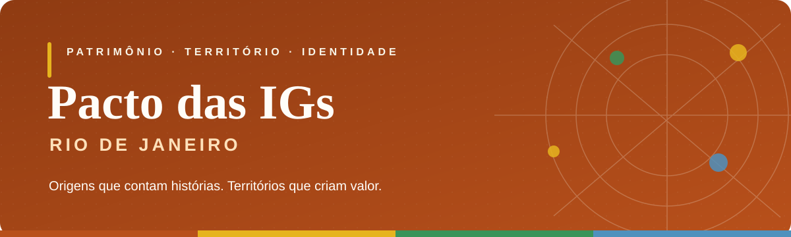

<div align="center">



<br />

**Uma vitrine digital para as origens, os saberes e a identidade dos territórios fluminenses.**

<br />


**[Visão geral](#-sobre-o-projeto) · [Funcionalidades](#-o-que-você-encontra) · [Identidade](#-identidade-visual) · [Executar](#-como-executar) · [Estrutura](#-estrutura-do-projeto)**

</div>

---

## ✦ Sobre o projeto

O **Pacto das Indicações Geográficas do Rio de Janeiro** ganha, neste projeto, um espaço digital pensado para **informar, conectar e valorizar** as Indicações Geográficas (IGs) e os territórios que elas representam.

Mais do que apresentar informações, a proposta da plataforma é aproximar visitantes, produtores, instituições e pessoas interessadas no tema, combinando **clareza institucional**, **navegação intuitiva** e uma **linguagem visual acolhedora**.

> **Cada origem carrega uma história. Nosso papel é ajudar a torná-la visível.**

## ◈ O que você encontra

| Área | Experiência proposta |
|:--|:--|
| **Início** | Apresentação do Pacto com uma primeira impressão visual marcante. |
| **Sobre** | Contextualização da iniciativa e de sua importância para os territórios. |
| **IGs em destaque** | Espaço de valorização das identidades e origens representadas. |
| **Notícias** | Divulgação de novidades, eventos e conteúdos relacionados ao Pacto. |
| **Mapa das IGs** | Acesso visual à dimensão territorial das Indicações Geográficas. |
| **Projetos aprovados** | Página dedicada à consulta de projetos, com recursos de busca e filtragem. |
| **Junte-se a nós** | Canal de aproximação e contato com a iniciativa. |

## ✳ Direção de design

A interface foi concebida para transmitir **credibilidade sem distanciamento**. A composição busca equilibrar elegância editorial, elementos orgânicos, espaços de respiro e cores associadas à riqueza cultural e territorial do estado.

### 🎨 Identidade visual

| Cor | Código | Papel na interface |
|:--|:--|:--|
|  **Terracota** | `#B8501B` | Cor principal e destaques |
|  **Dourado** | `#E6B41E` | Acentos e detalhes |
|  **Verde** | `#399459` | Elementos complementares |
|  **Azul** | `#4F91BD` | Apoio visual |
|  **Palha** | `#F9F6E9` | Fundos e suavidade |
|  **Tinta** | `#3B2A1C` | Textos e contraste |

**Tipografia:** `Crimson Pro` para títulos e `Open Sans` para os textos de interface.

## ⚙️ Tecnologias

O projeto utiliza tecnologias web fundamentais, com uma abordagem leve e acessível:

- **HTML5:** organização semântica das páginas;
- **CSS3:** identidade visual, layout e adaptação entre telas;
- **JavaScript:** interações e comportamentos de interface.

Não é necessário instalar um framework para visualizar as páginas estáticas.

## 🚀 Como executar

1. Clone o repositório:

   ```bash
   git clone https://github.com/SEU-USUARIO/SEU-REPOSITORIO.git
   ```

2. Acesse a pasta do projeto:

   ```bash
   cd SEU-REPOSITORIO
   ```

3. Abra o arquivo HTML principal no navegador ou utilize a extensão **Live Server** no VS Code.

> **Antes de publicar:** substitua `SEU-USUARIO` e `SEU-REPOSITORIO` pelo endereço real do repositório. Se o site tiver recursos que dependem de um servidor ou integrações externas, configure-os conforme a implementação.

## 🗂 Estrutura do projeto

A organização abaixo é **ilustrativa**. Ajuste os nomes conforme os arquivos presentes no repositório:

```text
pacto-das-igs-rj/
├── index.html                 # Página inicial
├── projetos.html              # Página de projetos aprovados
├── style.css                  # Estilo da página principal
├── projetos.css               # Estilo da página de projetos
├── assets/
│   └── banner-readme.svg     # Capa deste README
└── README.md                  # Documentação do projeto
```

## 🧭 Princípios da experiência

**01 · Informar com clareza**  
Apresentar o conteúdo de forma organizada, encontrável e compreensível.

**02 · Valorizar as origens**  
Dar protagonismo aos territórios, aos seus produtos e às suas histórias.

**03 · Criar proximidade**  
Transformar uma presença institucional em uma experiência digital mais humana.

**04 · Navegar sem barreiras**  
Priorizar uma interface responsiva, com leitura confortável no desktop e no celular.

## 📷 Prévia do site

> **Espaço para imagens reais do projeto.** Para enriquecer a apresentação no GitHub, adicione capturas de tela da Home e da página de Projetos em `assets/` e substitua este bloco pelas imagens.

<!-- Exemplo:


-->

## 🤝 Sobre a iniciativa

Este repositório apresenta o **desenvolvimento da interface web do Pacto das IGs RJ**. Informações institucionais, listas de projetos e conteúdos publicados devem ser mantidos em conformidade com os dados oficiais da iniciativa.

---

<div align="center">

### **Valorizar a origem é fortalecer o futuro.**

*Pacto das Indicações Geográficas do Rio de Janeiro*

<sub>Desenvolvido com atenção à identidade, à experiência e à presença digital dos territórios.</sub>

</div>
